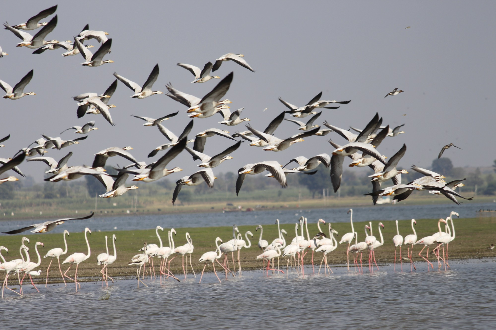

# What Birds Can Teach Your Team

Watch a flock of starlings turn across the evening sky and it looks choreographed. Hundreds of birds bank at once, split around a hawk, and merge again. Nobody is in charge.

In 1986 Craig Reynolds showed how this works with a computer simulation he called **boids**. Each simulated bird looks only at the few birds near it and follows three rules. Run that across a few hundred birds and a flock appears, with no leader and no plan.

*📸 **Ram Clicks...** Bar-headed geese lifting off while greater flamingos wade below. And no, this one isn't AI-generated. No prompt was typed. I just had to stand there with a camera and hope the geese felt like flying. Every bird, wing and flamingo knee is real (I counted the legs, so you don't have to).*

Look at the photo with the three rules in mind. Up in the air, the geese are using all three: no two wings touch (**separation**), every beak points the same way (**alignment**), and nobody has peeled off on a solo trip (**cohesion**). Down on the water, the flamingos run a slower version of the same rules: they spread out enough to feed, face roughly the same way, and stay together as one group. Same rules, different speed. Two flocks in one frame, and nobody in charge of either.

> **Try it:** open [`index.html`](index.html) in a browser. You can drag the three rules up and down, switch between team presets, and add "informed leaders" to see how few it takes to steer the group.

---

## The three rules

| # | Rule | What the bird does |
|---|------|--------------------|
| 1 | **Separation** | If a neighbour is too close, move away a little. |
| 2 | **Alignment** | Fly in the same direction as your neighbours. |
| 3 | **Cohesion** | Move toward the middle of your neighbours. Don't wander off. |

There's also a fourth setting that matters as much as the rules: the **vision radius**, meaning how far each bird looks. Shrink it and one flock breaks into many small ones that drift apart.

---

## For kids: how do birds fly together without a boss?

Have you ever seen a big group of birds swoop across the sky and all turn at the same moment? It looks like someone is giving orders, but nobody is. Each bird watches only the birds right next to it and follows three tiny rules:

1. **Don't bump.** If a friend is too close, scoot away a little.
2. **Go the same way.** Fly in the direction your friends are flying.
3. **Stay together.** Don't wander off alone. Move toward your friends.

That's all it takes. When every bird does this, the whole flock moves like one giant animal.

**Try it yourself:** in the simulation, slide *Cohesion* to 0 and watch everyone drift apart. Slide *Separation* to 0 and they squash into one blob. You can also try it at the playground: everyone walks around following the three rules, nobody leads, and you make your own flock.

---

## Where boids shows up in technology

Boids started in film and games, and that's still where it's used most. The idea spread wherever lots of agents have to coordinate without a central controller, each one reacting only to its neighbours.

### Where it started
- **Movies.** *Batman Returns* (1992) used boids for its bat swarms and penguin armies. Reynolds received a Scientific and Technical Academy Award in 1998 for this work.
- **Video games.** Birds, fish, crowds, and groups of units that move together without bumping. Reynolds' steering behaviours (seek, flee, follow a path, avoid obstacles) became a standard part of game AI.

### Machines that move
- **Drones and robots.** In 2018 researchers in Budapest flew about 30 drones outdoors as a true flock, each using only local rules. Swarm robotics projects such as Harvard's 1,000-robot Kilobots build on the same idea.
  *Most drone light shows are not boids, though. Each drone follows a path a central computer planned in advance.*
- **Traffic.** Adaptive cruise control and truck platooning use two of the rules directly: keep a safe gap (separation) and match the speed of the vehicle ahead (alignment).

### Science and safety
- **Biology.** Researchers use boids-style models to study starling murmurations, fish schools and locust swarms, testing which simple rules reproduce the shapes they see in the wild.
- **Crowd safety.** Evacuation simulators for stadiums, airports and metro stations use agent models from the same family, so designers can test exits before anything is built.

### Software, data and AI
- **Data engineering.** Many systems have parts that adjust to their neighbours at runtime with no master:
  - Cassandra's **gossip protocol**: nodes agree on cluster state by talking to a few peers.
  - **TCP congestion control**: every connection tunes its own speed and the network ends up shared fairly.
  - **Streaming backpressure** in Flink: each operator slows down when the next one is full.
- **AI agents.** Multi-agent systems are the closest match. In Stanford's *Generative Agents* study (2023), one AI agent was told to host a party. Invitations spread from agent to agent and guests showed up, and nobody scripted it. When agents share work without an orchestrator, you see the boids failure modes: duplicated tasks, clashing conventions, and drift away from the goal.

### What this means for testing AI
You can't read three rule weights and predict what the flock will do. You have to run it. AI agents work the same way: reading the prompts won't tell you how they'll behave. So you run evals, many times, because results vary from run to run, and you re-run the whole suite after every change.

---

## What a flock teaches a team

A good team, like a flock, doesn't need someone steering every move. It needs a few rules everyone follows and enough visibility to react to the people nearby.

| Flock rule | In a team | When it's missing |
|------------|-----------|-------------------|
| **Separation** | Clear ownership. Know what's yours and what's someone else's. | Two people fix the same pipeline. Groupthink and crowding. |
| **Alignment** | Shared direction: standards, data contracts, a common definition of done. | Lone wolves doing good work in different directions that doesn't add up. |
| **Cohesion** | Stay connected. Share progress, ask for help, help others. | People drift off and work alone, and the team stops being a team. |
| **Vision radius** | How far people look: across squads, not just their own. | Silos. Data, platform, QA and BI each form their own little flock. |

### The presets in the simulation

| Preset | Settings | What you see |
|--------|----------|--------------|
| **Healthy team** | Balanced separation, alignment, cohesion | The group moves together and still gives everyone room. |
| **Groupthink** | Almost no separation, very strong cohesion | Everyone piles into one spot and steps on each other. |
| **Silos** | Normal rules, tiny vision radius | Many small flocks form and drift apart. Widen the radius and they merge. |
| **Lone wolves** | Strong separation, no alignment or cohesion | Everyone heads off in a different direction. |
| **All process** | Very strong alignment, weak cohesion | Lanes all point the same way, but nobody pulls together. |

### Four lessons

1. **Good rules beat micromanagement.** A flock has no one shouting directions. Clear shared rules mean fewer decisions need escalating.
2. **Balance matters.** All "stay close" and no space gives you groupthink. All space and no "stay close" gives you silos.
3. **Widen your view.** Birds that watch only their nearest two neighbours form small separate groups. Teams do too.
4. **A few people can steer the group.** Couzin's research on animal groups (2005) found that a small share of informed members can guide a whole group. Share context and others will follow. In the simulation, about 5% of the birds are enough.

> **Great teams aren't built by controlling everyone. They're built by agreeing on a few simple rules that everyone follows.**

One caution: this is a metaphor. People plan, remember and talk to each other, and birds don't. Use it to start a conversation, not to model your org chart.

---

## How the simulation works

[`index.html`](index.html) is a single file with no dependencies: plain HTML, CSS and a canvas.

- Each frame, every boid sums three steering forces from neighbours inside its vision radius: **alignment** (average heading), **cohesion** (average position), and **separation** (inverse-square push from anything inside half the radius). Each force is weighted by its slider value.
- A uniform spatial grid with cell size equal to the vision radius means each boid checks only nine cells, which keeps 400 birds smooth.
- The world wraps around at the edges (it's a torus), and neighbour distances account for the wrap.
- **Informed leaders** (orange, about 5% of the flock) add a fourth force toward a goal that moves every 7 seconds. The rest of the flock follows them with no extra rule.
- The pointer acts as a predator: boids within 90px steer away from it.
- The page follows light and dark mode and slows the birds down when the system asks for reduced motion.

---

## Further reading

- Craig Reynolds, [Boids](https://www.red3d.com/cwr/boids/), his own page, including the 1987 SIGGRAPH paper *Flocks, Herds, and Schools: A Distributed Behavioral Model*.
- Couzin et al., *Effective leadership and decision-making in animal groups on the move*, Nature (2005).
- Park et al., *Generative Agents: Interactive Simulacra of Human Behavior* (2023).
