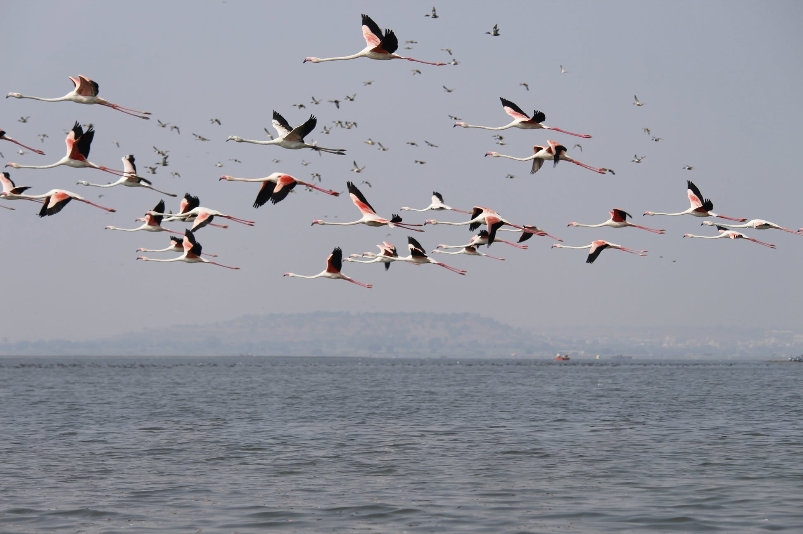

# What Birds Can Teach Your Team

A small interactive flocking simulation and a blog post about what it teaches teams.

Each bird follows three local rules: keep your distance (separation), match direction (alignment) and stay together (cohesion). A flock forms with no leader. The same three rules say a lot about how teams work.

## Run it

Try it live at [ramanathanapa.github.io/what-birds-teach-teams](https://ramanathanapa.github.io/what-birds-teach-teams/).

To run it locally, open `index.html` in a browser. There is nothing to install or build.

The page loads its fonts from Google Fonts, so it falls back to system fonts when you are offline.

## What you can do

- **Move the sliders** for the three rules, vision radius, speed and number of birds.
- **Switch team presets:** Healthy team, Groupthink, Silos, Lone wolves, All process.
- **Read the score** under the sky: number of flocks, birds flying alone, and the share flying the same direction.
- **Take the challenge:** "Challenge: fix a team" gives you a broken team and times how long you take to fix it.
- **Add informed leaders** to see how few birds it takes to steer the flock.
- **Click the sky** to add birds, and move the pointer over it to scare them away.

## Files

| File | What it is |
|------|------------|
| [`index.html`](https://github.com/ramanathanapa/what-birds-teach-teams/blob/main/index.html) | The simulation and the article page, in one file with no dependencies. |
| [`blog.md`](https://github.com/ramanathanapa/what-birds-teach-teams/blob/main/blog.md) | The blog post, with a team checklist and a 15-minute team exercise. |
| [`images/`](https://github.com/ramanathanapa/what-birds-teach-teams/tree/main/images) | The flamingo photo, taken by Ram Clicks at Bhigwan, Maharashtra. |

## Credits

- Boids is by Craig Reynolds (1986). See his [Boids page](https://www.red3d.com/cwr/boids/).
- The leader idea comes from Couzin et al., *Effective leadership and decision-making in animal groups on the move*, Nature (2005).
