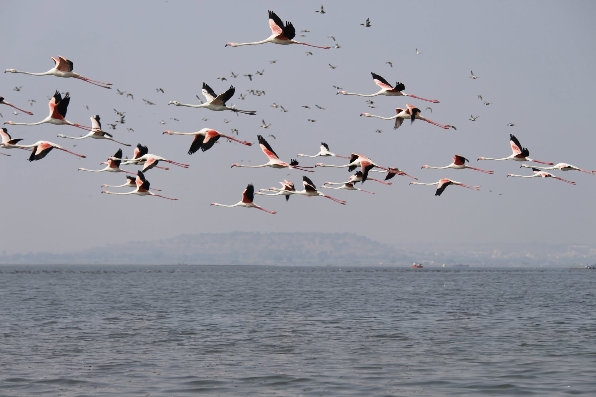

# What Birds Can Teach Your Team

Watch a flock of starlings turn across the evening sky. Hundreds of birds bank at once, split around a hawk, and merge again. Nobody is in charge.

In 1986 Craig Reynolds copied this on a computer with a simulation he called **boids**. Each bird looks only at the few birds near it and follows three rules. That's enough to make a flock.

*📸 **Ram Clicks...** Greater flamingos in flight over the water. And no, this one isn't AI-generated: no prompt was typed. Taken at Bhigwan, Maharashtra.*

You can see all three rules in the photo. No two wings touch, every beak points the same way, and nobody has flown off alone.

---

## The three rules

| Rule | For the bird | For your team |
|------|--------------|---------------|
| **Separation** | Don't bump. If a neighbour is too close, move away a little. | Know what's yours and what's someone else's. |
| **Alignment** | Go the same way as your neighbours. | Share a direction: the same standards and the same definition of done. |
| **Cohesion** | Stay together. Don't wander off alone. | Stay in touch. Share progress, ask for help, give help. |

One more setting matters as much as the rules: **how far each bird looks**. Birds that watch only their nearest neighbours break into small flocks that drift apart. Teams that look only at their own squad become silos.

> **Try it:** open the [live simulation](https://ramanathanapa.github.io/what-birds-teach-teams/). Drag the three rules up and down and watch what happens to the flock.

---

## Which flock is your team?

Find the row that sounds like your team. Each one matches a preset in the simulation, so you can see it happen.

| What you notice | What's off | Try this week |
|-----------------|------------|---------------|
| Two people fix the same thing. Everyone agrees quickly in meetings. | Too little separation (**Groupthink**) | Put one owner's name on each piece of work. In each review, ask one person to argue the other side. |
| Good work that doesn't fit together. Every project has its own style. | Too little alignment (**Lone wolves**) | Write your standards and definition of done on one page. If it doesn't fit on a page, cut it. |
| People stay stuck for days without telling anyone. | Too little cohesion | Hold a 10-minute daily check-in: what I'm working on, where I'm stuck. Agree that anyone stuck for half a day asks for help. |
| Other teams' changes keep surprising you. | Looking too near (**Silos**) | Sit in on another team's demo once a month. Post changes in a shared channel before they ship. |
| Everyone follows the process, but nobody helps anyone. | All alignment, no cohesion (**All process**) | Drop one rule nobody can explain. Pair two people on one task. |

---

## A 15-minute team exercise

1. Open the simulation on a shared screen.
2. Click through the presets: Healthy team, Groupthink, Silos, Lone wolves, All process.
3. Ask everyone: *which one looks most like us?*
4. Pick the one slider you would move, and agree on one action from the table above.
5. Check again in a month.

It also works without a screen. Everyone walks around the room following the three rules: keep your distance, match direction, stay together. Nobody leads, and a flock forms anyway.

---

## Four things to remember

1. **Good rules beat micromanagement.** A flock has nobody shouting directions. When the rules are clear, fewer decisions need a manager.
2. **Balance matters.** Too close and you get groupthink. Too far apart and you get silos.
3. **Look further.** Know what the teams around you are doing, as well as your own.
4. **A few people can steer the group.** Research on animal groups (Couzin, 2005) found that a small share of informed members can guide the whole group. In the simulation about 5% of the birds are enough. So you don't have to brief everyone in detail. Make sure a few people on each team really know the goal and the reason for it.

> **Agree on a few simple rules, and you won't need to control everyone.**

One caution: this is a metaphor. People plan, remember and talk to each other, and birds don't. Use it to start a conversation with your team. Don't use it to redraw your org chart.

---

## Where the same idea is used

- **Movies and games.** *Batman Returns* (1992) used boids for its bat swarms and penguin armies. Games use it for birds, fish and crowds.
- **Drones and robots.** In 2018 researchers in Budapest flew about 30 drones as a real flock, each following only local rules.
- **Traffic.** Adaptive cruise control keeps a safe gap (separation) and matches the speed of the car ahead (alignment).
- **Crowd safety.** Evacuation simulators let designers test the exits of a stadium or station before it's built.
- **Optimisation.** In 1995 Kennedy and Eberhart were simulating a bird flock and found it could search for answers. Their particle swarm optimisation is still in use: many guesses move through the problem, each pulled toward the best spot it has found and the best its neighbours have found.
- **Databases with no master.** Apache Cassandra has no node in charge. Every second each node swaps status with a few others, and the whole cluster soon agrees on which nodes are up. This "gossip" wasn't built from boids, but it is the same principle: local exchanges, no central controller.
- **Teams of AI agents.** The three rules map directly: one owner per task (separation), shared instructions and output format (alignment), a shared record of progress (cohesion). Leave one out and you get duplicate work, clashing styles or agents drifting off goal.

A tip if you build with AI agents: you can't predict a flock by reading its three rule settings. You have to run it. Agents are the same, and reading the prompts won't tell you how they behave. Run your evals many times, and run them again after every change.

---

## Further reading

- Craig Reynolds, [Boids](https://www.red3d.com/cwr/boids/), his own page, including the 1987 paper *Flocks, Herds, and Schools: A Distributed Behavioral Model*.
- Couzin et al., *Effective leadership and decision-making in animal groups on the move*, Nature (2005).
- The code is on GitHub: [ramanathanapa/what-birds-teach-teams](https://github.com/ramanathanapa/what-birds-teach-teams). The simulation is one file, [`index.html`](https://github.com/ramanathanapa/what-birds-teach-teams/blob/main/index.html), with no dependencies.
